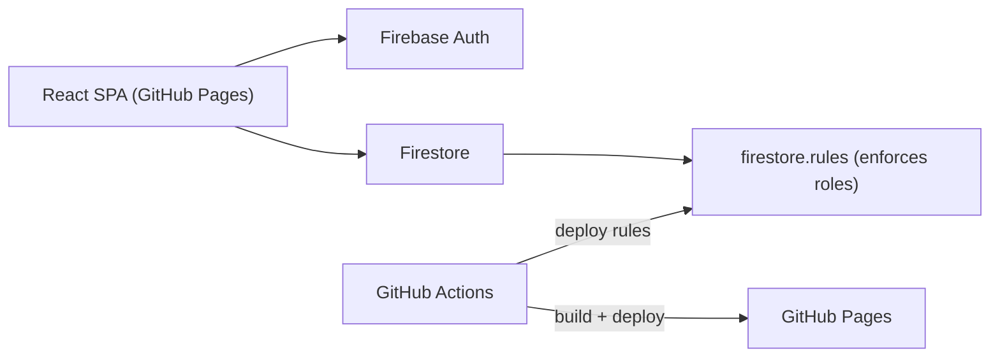

# Malcolm X Respiratory Therapy Class Announcements

## How the pieces fit

GitHub Pages only serves the built HTML, JavaScript and CSS files. The browser talks directly to Firebase. All permission checks happen in `firestore.rules`, which run on Firebase's side, so a user can't bypass them by editing the JavaScript.



## Stack and versions (latest on npm as of Oct 2026)

These are the versions to install. They will be pinned in `package.json` when the project is created.

- Node 24.19 (already installed).
- React 19.3.
- Vite 8.3, with `@vitejs/plugin-react` 6.1.
- TypeScript 6.0.3, kept light: see the simplifications below.
  - TypeScript 7.0 is out, but the ESLint TypeScript plugin `typescript-eslint` 8.71 only supports versions below 6.1.
  - Your `ih_planner` project uses the same ESLint setup, so TypeScript 6.0 keeps the two projects consistent.
- `react-router` 8.4.
  - This one package now replaces `react-router-dom`.
  - It uses a hash router, so URLs work on GitHub Pages, which can't rewrite URLs on the server.
- `firebase` 12.19, the modular SDK for Auth and Firestore. Everything stays on the free Spark plan.
- Tailwind CSS 4.3, set up through the `@tailwindcss/vite` plugin with no config file.
- Vitest 5.0 for tests.
- `firebase-tools` 15.32, the Firebase command-line tool, used to deploy `firestore.rules` and indexes. It doesn't need Java for this.
- **Local emulator deferred to phase 6:**
  - Until then, development runs against the real free Firebase project. A class-sized app in development stays far under the daily quota.
  - In phase 6, install Java 21 (the free Eclipse Temurin build) with `winget install EclipseAdoptium.Temurin.21.JDK`.
  - Then add the emulator config and `@firebase/rules-unit-testing` 5.0 for automated rules tests.
- **UI kit, same as `ih_planner`:**
  - shadcn/ui components (style `new-york`, base color `neutral`) built on Radix.
  - `lucide-react` icons and `sonner` toast notifications.
  - `@tanstack/react-table` (MIT, free) for the admin data tables, following shadcn's data-table pattern. Added in phase 5.
  - Relative times ("3h ago") use the built-in `Intl.RelativeTimeFormat`, no date library.
  - `clsx`, `tailwind-merge` and `class-variance-authority`, combined through a `cn()` helper.
  - `tw-animate-css` for animations.
- **Tooling, same as `ih_planner`:**
  - ESLint 9 using the same flat config: `typescript-eslint`, react, react-hooks, sorted import order, `consistent-type-imports`, `curly: all`, and blank lines around control statements.
  - Prettier 3 with single quotes, semicolons, 4-space indentation, 80-character lines, and `prettier-plugin-tailwindcss` (which also sorts classes inside `cn`, `clsx` and `cva`).
  - Scripts: `dev`, `build`, `lint`, `lint:check`, `format`, `format:check`, `types:check`, `test`.

## Keep-it-simple choices for the first version

- **Light TypeScript:**
  - Data shapes (`ClassGroup`, `Role`, `UserProfile`, `UserContact`, `Post`, `Comment`) are typed once in [src/types/index.ts](src/types/index.ts).
  - Everything else relies on type inference, so most code looks like plain JavaScript.
  - No advanced generics.
- **Plain forms:** `useState` with controlled inputs and a small manual check before saving. No form libraries.
- **Plain-text posts at first:** line breaks are preserved. `react-markdown` comes later, together with image links.
- **No data-fetching library:** a few small custom hooks wrap Firestore's live listener (`onSnapshot`).
- **Roles:**
  - Seed three default roles: Admin, Moderator and Student.
  - The first admin screen only assigns roles to users.
  - The full custom-role editor comes in a later phase. The data model already supports it, so nothing has to be rewritten.
- **Deploy early:** a "hello world" page goes live on GitHub Pages on day 1, so hosting problems show up early.

## Firestore compared with MySQL

Firestore has no SQL. Here is how its concepts map to what you know:

- A **collection** is like a table. A **document** is like a row, but it's stored as JSON with no fixed schema.
- A **document ID** is like a primary key.
- A **subcollection** (`posts/{id}/comments`) is like a child table whose foreign key is built into its path.
- **There are no JOINs.** Either copy values onto each document or "join" on the client. At class size this app joins on the client (see Data model).
- **No foreign keys, cascades, or unique constraints** except the document ID. Rules can check `exists()`; uniqueness comes from meaningful IDs (`roles/admin`, `users/{uid}`).
- **A pivot table is a subcollection keyed by the other side's ID** (`classes/{classId}/members/{uid}`). Rules can't run queries, but they can `get()`/`exists()` one known path, so "is this user in this class?" is a single lookup. Small lists that are never looked up from the other side stay as arrays (`roleIds`).
- **A foreign key is either a path segment** (`classes/{classId}/posts/...` — the post can't exist outside its class) **or an ID field** (`userId`). Nothing enforces them; rules act as the constraint (`exists()` on create), and there are no cascades (we soft delete / archive instead).
- **Rules can't query or loop** and allow at most 10 document lookups per request, so permission checks must be shallow (hence the stored `permissions` array).
- **Rules are per document, not per field** — private fields go in a separate document (`userContacts`).
- **A missing field is not null** — always write `deletedAt: null` on create.
- **You pay per document read**, not per query (Spark: 50k reads / 20k writes / 20k deletes per day, 1 GiB stored). Design for reads.
- `where`, `orderBy` and `limit` in the SDK work like `WHERE`, `ORDER BY` and `LIMIT`.
- Queries that filter or sort on several fields need a **composite index**, declared in `firestore.indexes.json`.
- **Security rules** act like MySQL `GRANT`s plus per-row checks in one file. Every read and write passes through them.

## Authentication (school email only)

- Students sign up with email and password, then must verify their email before they can do anything.
- Allowed domains (confirmed): `@student.ccc.edu` for students and `@ccc.edu` for instructors.
  - They're set once in [src/lib/config.ts](src/lib/config.ts) as `ALLOWED_EMAIL_DOMAINS = ['student.ccc.edu', 'ccc.edu']`.
  - The same pattern appears in `firestore.rules`.
- The domain check is case-insensitive, so `Name@Student.CCC.edu` also works.
- The domain restriction is enforced twice:
  - In the UI, so users get a clear error.
  - In `firestore.rules`, which is the actual protection:

```
function isMember() {
  return request.auth != null
    && request.auth.token.email_verified == true
    && request.auth.token.email.lower().matches('^[^@]+@(student[.])?ccc[.]edu$');
}
```

- Optional later: add a "Sign in with Microsoft" button, since City Colleges of Chicago uses Microsoft 365.

### Account creation — decided 2026-10-08

Two ways an account gets created; both end in the same stepper.

- **Self sign-up (stepper at `/signup`):**
  1. **Account:** school email + password (domain check via `isAllowedEmail`).
  2. **Verify email:** send the link; "I've verified" button reloads the user; "Resend" button.
  3. **Profile:** first name, last name, contact number (E.164) + SMS opt-in, and **pick your class** (active classes). Creates `users/{uid}` (pending, `createdBy: null`), `userContacts/{uid}` and `classes/{classId}/joinRequests/{uid}`.
  4. **Done:** pending users go to `/pending` (shows their join request with Cancel, or a class picker to request one); users who already have a class go to the board.
  - The current step is **derived from account state**, not stored: signed in but unverified → step 2; verified with no profile (or no name) → step 3. Closing the tab and logging in later resumes at the right step.
- **Invited (class Students page → "Invite student", anyone whose role in that class has `students.manage`, or a super admin):**
  - The inviter enters first/last name, school email and a role ranked below their own. The user is approved immediately; `users.createdBy` = inviter's uid, `users.createdInClassId` = the class, `members.addedBy` = inviter's uid.
  - The browser can't create someone else's login with the normal client SDK (that needs the Admin SDK on a server = Blaze). Free workaround: a **second Firebase app instance** (`initializeApp(config, 'admin-create')`) calls `createUserWithEmailAndPassword` so the admin stays signed in on the main instance, then signs out of the second instance.
  - The temporary password is random (`crypto.getRandomValues`), never shown or stored. The admin then calls `sendPasswordResetEmail`, so Firebase emails the student a **"set your password" link** — free, from Firebase's own mailer.
  - The creator writes `users/{newUid}` and the class membership in one batch.
  - The student sets a password, logs in, verifies their email (step 2) and confirms their profile and contact number (step 3), then lands on the board.
  - `auth/email-already-in-use` shows a clear error ("ask them to log in and request to join this class"). Existing accounts join another class through a join request from `/pending` (class managers can't list all users).
  - If the login is created but the Firestore batch fails, the Auth account is left without a profile; the student can still log in and finish sign-up normally.
- **Deleting a user** is a soft delete (`deletedAt`). The client can't delete or disable someone else's Auth login without the Admin SDK; rules block soft-deleted users from everything (`isActive()`). If ever needed, the login can be disabled by hand in the Firebase console (or the Firebase MCP's `auth_update_user`).

## Data model (Firestore) — decided 2026-10-08

Designed normalized first (MySQL-style ERD), then mapped to Firestore. Field names are camelCase so documents map straight onto the TS types.

**Conventions on every collection:**

- `createdAt` and `updatedAt` are server timestamps (`serverTimestamp()`); rules check `createdAt == request.time` on create and `updatedAt == request.time` on every write.
- Soft delete (`users`, `posts`, `comments`): `deletedAt: Timestamp | null`. Every create writes `deletedAt: null` explicitly, because Firestore's `where('deletedAt', '==', null)` doesn't match documents where the field is missing. Rules enforce it.
- IDs are Firestore auto IDs, except `users/{uid}` (Firebase Auth uid) and `roles/{slug}` (readable, unique by construction).

**The class is the anchor; roles belong to classes (decided 2026-10-08, built in Phase 2b).** All class data lives under `classes/{classId}`; the path is the foreign key. Each class has its **own roles** (Class A: Student, President, Treasurer; Class B: Student, Pres, Treasurer, Secretary) with their own permissions. The only app-wide role is **super admin** (the user), who manages every class. Hierarchy: **super admin → class → roles**.

"Officer" is not a concept in the code: officers are just whatever roles a class creates with admin permissions (`admin.access`, `students.*`, `roles.manage`). Typical setup: the super admin creates the class, adds its roles (e.g. President with `roles.manage` + `students.manage`), invites the first President, and the President takes it from there.

```
admins/{uid}                     super admins (only a super admin writes here)
classes/{classId}
  roles/{roleId}                 this class's roles (master table per class)
  members/{uid}                  pivot: class_members (class_id, user_id, role_id)
  joinRequests/{uid}             pending sign-ups asking to join this class
  posts/{postId}                 FK class (path), userId
    comments/{commentId}         FK post (path), userId, parentId (self FK)
users/{uid}                      people (one per Auth login)
userContacts/{uid}               1:1 with users, private (SMS consent)
```

**Collections:**

- `admins/{uid}`: `{ createdAt }`. Super admin = this doc exists. Separate collection so no class role can ever grant it; first one is created by hand (console/MCP). Super admins can do everything in every class plus app-wide pages (all classes, all users, super admins).
- `classes/{classId}`: `{ name, startYear, endYear | null, archivedAt | null, createdAt, updatedAt }`
  - Only super admins create / edit / archive classes. A class is archived instead of deleted.
  - Creating a class also creates one default role in the same batch: **Student** (id `student`, rank 1, `posts.create`), so self sign-up join requests can be approved right away. The super admin adds every other role.
- `classes/{classId}/roles/{roleId}` (per-class master table, no enums): `{ name, color, rank, permissions: string[], createdAt, updatedAt }`
  - **`rank`** (number, higher = more power) gives a Discord-style hierarchy: you can only create/edit/delete roles ranked **below** your own role, and only manage members whose role is ranked below yours.
  - Deleting a role is blocked in the UI while members still hold it.
- `classes/{classId}/members/{uid}` (pivot): `{ userId, roleId, phone, addedBy, createdAt, updatedAt }`
  - **Exactly one role per person per class** (user decision) → rules `get()` the role directly; no stored permission copies, and editing a role's permissions applies to everyone instantly. A Treasurer is still a student — their role just includes `posts.create`.
  - Doc ID = uid (rules check membership with one `exists()`); `userId` repeats it for collection-group queries ("my classes", index on `members.userId`).
  - `addedBy`: uid of whoever approved the join request / added them (audit).
  - `phone`: copy of the member's phone (E.164 or `''`) so **all classmates can see it** (user decision: promotes communication). Rules can't check "shares a class" on `userContacts`, so the number is copied per membership. Written by the member themselves (profile save updates every membership in one batch) and on approval (copied from the join request). This is the one deliberate denormalization.
  - Removing someone from a class deletes the pivot doc; their posts stay.
- `classes/{classId}/joinRequests/{uid}`: `{ userId, phone, createdAt }`
  - Sign-up's profile step asks the student to **pick their class** (active classes). Anyone whose role in that class has `students.manage` approves (batch: create member with a role ranked below theirs, defaulting to the lowest, + delete request) or rejects (delete request). Pending users can also request from `/pending`.
- `users/{uid}`: `{ firstName, lastName, email, createdBy | null, createdInClassId | null, createdAt, updatedAt, deletedAt }`
  - **`createdBy`**: `null` for self sign-up; otherwise the uid of whoever invited them (rules: must equal the creator's uid). **`createdInClassId`**: the class they were invited into; the rules use it to check the inviter has `students.manage` there and that the membership is created in the same batch (`existsAfter`).
  - **Pending** = no memberships (and not a super admin).
  - Deactivate/restore (`deletedAt`) is super admin only, since a person can be in several classes. Class managers remove people from *their* class instead.
  - Email must be `@student.ccc.edu` or `@ccc.edu` (copied from Auth; rules check it matches the token).
- `userContacts/{uid}`: `{ phone, smsOptIn, smsOptInAt | null, updatedAt }`
  - Source of truth for the phone + SMS consent; readable by the owner and super admins only. Classmates see the membership copy.
  - `phone` is stored in E.164 format (`+13125551234`). The opt-in flag and its timestamp are kept now so SMS later needs no migration (US texting requires consent).

**Class permissions** (code constants in `src/lib/permissions.ts`, shown as checkboxes in each class's role editor; all apply only inside that class):

| Permission | Allows |
|---|---|
| `admin.access` | Open the admin panel for this class |
| `students.view` | See the class roster (names, roles) in the admin panel |
| `students.manage` | Approve/reject join requests, add students (existing users or new accounts via set-password email), change their role, remove them from the class |
| `roles.manage` | Create/edit/delete roles ranked below their own, and set those roles' permissions |
| `posts.create`, `posts.edit_any`, `posts.delete_any`, `posts.pin`, `comments.delete_any` | Content |

- **No escalation:** a role can only be given permissions the editor's own role has.
- Example (Class A): Student = `posts.create`. President = everything. The President gives Treasurer `admin.access` + `students.view` (+ `posts.create`) but not `students.manage` → Treasurer opens the admin panel and sees the roster but can't change students.
- `classes/{classId}/posts/{postId}`: `{ userId, title, body, links: { url, label }[], pinned, createdAt, updatedAt, deletedAt }`
  - Belongs to its class by path; exactly one author (`userId`).
  - `links` is embedded (max ~10): files live in external apps (Drive, OneDrive, Cloudinary later) and the post only references them. Links are never queried alone, so a subcollection would only add one read per post in the feed.
- `classes/{classId}/posts/{postId}/comments/{commentId}`: `{ userId, parentId | null, body, createdAt, updatedAt, deletedAt }`
  - Class and post come from the path, so rules check membership without reading the post. "All posts/comments by a user" or admin moderation tables use collection-group queries.
  - Threaded replies: the client builds the reply tree from `parentId` (depth limit 5). Soft-deleted comments show as "[deleted]" so their replies stay in place, like Reddit.

**Joins and counts (stay normalized at class size):**

- Author names are not copied onto posts or comments. The app loads the current class's users once (about 40 reads) into a map and looks up `userId → name` on the client. If the app grows to hundreds of users per class, copy `authorName` onto posts then.
- Comment counts use Firestore's `count()` aggregation (not live). A stored `commentCount` is the fallback if live counts are needed.

## Authorization rules (summary for [firestore.rules](firestore.rules))

- Every read requires `isMember()`, so nothing is public.
- `isActive()` = `isMember()` + own `users` doc exists with `deletedAt == null`. Everything beyond reading/creating your own profile requires it, so soft-deleted users are locked out.
- `isSuperAdmin()` = active + `exists(admins/{me})`. `inClass(c)` = super admin or `classes/c/members/{me}` exists. `canIn(c, p)` = super admin, or `p in get(classes/c/roles/{myMember.roleId}).permissions` (2 lookups). `myRank(c)` = that role's `rank` (super admin = unlimited).
- `users/{uid}`:
  - Self-create: own doc only, `createdBy == null`, `deletedAt: null`.
  - Invited (new account): `createdBy == request.auth.uid`, `canIn(createdInClassId, 'students.manage')`, and `existsAfter(classes/{createdInClassId}/members/{uid})` — the membership is created in the same batch.
  - Self-update: only `firstName` and `lastName`. Deactivate/restore: super admin only.
  - Any active account can `get` a single profile (names for the client-side join); only super admins can `list` the collection.
- `classes/{c}/members/{uid}`: readable by members of that class (roster + phone), the person themselves (collection-group "my classes"), and super admins. Create/update/delete need `students.manage` in `c`, the target's current and new role must rank **below** `myRank(c)`, and create checks the foreign keys (`exists` class, `existsAfter` user, `exists` role). `addedBy == request.auth.uid`. The member can update only their own `phone` copy.
- `classes/{c}/roles/{roleId}`: readable by class members; create/update/delete need `roles.manage` in `c`, `rank < myRank(c)` (before and after), and `permissions.hasOnly(myRole.permissions)`.
- `classes/{c}/joinRequests/{uid}`: created by the requester (pending, own uid); read/delete by `students.manage` in `c` and the requester.
- `userContacts/{uid}`: written only by the owner; read by the owner and super admins.
- `classes`: readable by active accounts; only super admins write. `admins`: only super admins read/write.
- `posts` (`classes/{c}/posts`):
  - Create requires `canIn(c, 'posts.create')` and `userId` must equal the logged-in user.
  - Update is allowed for the author, or anyone with `posts.edit_any`. `pinned` can only change with `posts.pin`.
  - Delete is allowed for the author, or anyone with `posts.delete_any`.
  - Delete means soft delete (`deletedAt` set). Restoring (`deletedAt` back to `null`) and soft-deleted items in admin tables require `posts.delete_any` (`comments.delete_any` for comments).
- `comments`:
  - Any verified member can create a comment as themselves.
  - The author can edit or soft-delete their own comment.
  - Anyone with `comments.delete_any` can moderate comments.
- Each `get()`/`exists()` counts toward the 10-lookup limit per request (20 per batch); class checks cost ~2–4.
- The first super admin is set up once by hand (Firebase console or MCP): create `admins/{uid}`.

## Two interfaces, one SPA — decided 2026-10-08

One React app, one `index.html`. Two nested layout routes in `src/router.tsx` give two different looks:

- **Student board (Reddit-style)** — `board-layout.tsx`, routes at `/`.
- **Admin panel (CRM-style)** — `admin-layout.tsx`, routes under `/admin/*`, **lazy-loaded** (route `lazy`) so students never download admin code. This also trims the main bundle.

Both use the same hooks, types, `AuthProvider` and `firestore.rules`; only the layouts and page components differ.

### Student board (Reddit-style)

- **Top bar:** app name, **class switcher** (like switching subreddits; only shows when a user has more than one class), title search (client-side filter), "Create post" button (if `posts.create`), user menu (profile, admin panel link if the user has any admin permission, log out).
- **Feed (center column):** compact post cards — title, author, relative time, link chips, comment count. Pinned posts first ("Pinned" badge), then newest. "Load more" paging of 20.
- **Right sidebar (`lg` and up only):** class info card (name, years, member count), pinned quick links.
- **Post page:** post with its links, then the **threaded comment tree** — indented replies with thread lines, collapse/expand per thread, inline reply box, "[deleted]" placeholders, depth limit 5 ("Continue this thread" link beyond it).
- **Mobile:** single column; the sidebar content moves into a sheet/drawer; large touch targets.

### Admin panel (CRM-style)

- **Shell:** collapsible left sidebar (shadcn `sidebar`), top bar with breadcrumbs and user menu, "Open board" button (opens `/` in a new tab). On mobile the sidebar becomes a drawer.
- **Landing (decided 2026-10-08):** after login, users with any admin permission land on `/admin`; everyone else on `/`. Opening `/` directly never redirects, so admins can keep the board open in a second tab. URLs stay hash-based (`/#/admin/users`) — the user chose this over clean URLs with a `404.html` fallback.
- **Access:** super admins, plus anyone whose role in some class has `admin.access`; each class page is gated by its own class permission, in the UI **and** in `firestore.rules`.
- **Data tables** (shadcn data-table pattern on `@tanstack/react-table`): search, filters (class, role, status: active / pending / deleted), sortable columns, pagination, column visibility, row selection with **bulk actions**.
  - Filtering and search run in memory: at class scale the admin loads the whole collection (a few hundred documents). Firestore has no `LIKE`/full-text search; if this ever grows past that, add lowercase prefix-search fields first.
- **Record detail pages:** tabs for profile, contact info, classes and roles, and activity (that user's posts and comments).

Two levels (decided 2026-10-08). Class managers see a **class switcher** listing only classes where their role has `admin.access`; super admins see every class plus the app-wide pages.

| Route | Who | Purpose |
| --- | --- | --- |
| `/admin` | any admin access | Redirects to All classes (super admin) or your first class |
| `/admin/classes/:classId` | `admin.access` in that class | Redirects to the first class page your role allows |
| `/admin/classes/:classId/students` | `students.view` / `students.manage` | Class roster with search by first/last name, phone, role; join requests (approve/reject); add student (existing user or new account); change role; remove from class |
| `/admin/classes/:classId/roles` | `roles.manage` | This class's roles: name, color, rank, permission checkboxes (only roles ranked below yours) |
| `/admin/classes/:classId/posts` | `posts.delete_any` / `comments.delete_any` | Moderation tables incl. soft-deleted items; restore |
| `/admin/classes` | super admin | All classes: create (with the default Student role), edit, archive, member counts |
| `/admin/users` | super admin | All users: search, deactivate/restore, `createdBy`, which classes they're in |
| `/admin/admins` | super admin | Super admins list (later; first one by hand) |

### Other routes

- `/login`, `/signup` (the stepper; also hosts the verify-email and profile steps) and `/forgot-password` use `auth-layout.tsx` and are open to anyone.
- `/pending` is shown to signed-in users with no class yet ("waiting for an admin to add you to a class").
- `/posts/new` and `/posts/:id/edit` require the `posts.create` permission or post ownership.
- `/profile` lets users change their name and contact number (with SMS opt-in).
- Each page handles loading, empty and error states.
- An `AuthProvider` context exposes `user`, `profile` and `can(permission)`.

## Proposed structure (mirrors `ih_planner/resources/js`)

All filenames are kebab-case, such as `post-card.tsx` or `use-posts.ts`. Imports use the `@/` alias, which points to `src/`.

- [src/main.tsx](src/main.tsx) and [src/router.tsx](src/router.tsx): app entry point and the single list of routes.
- [src/index.css](src/index.css): sets up Tailwind v4 (`@import "tailwindcss"`) and the theme through `@theme`.
- [src/components/ui/](src/components/ui/): shadcn components such as `button`, `input`, `card`, `dialog` and `dropdown-menu`.
- [src/components/](src/components/): app components, grouped into subfolders as in `ih_planner`:
  - `components/board/`: `board-top-bar`, `class-switcher`, `class-sidebar`.
  - `components/posts/`: `post-card`, `post-form`, `link-chips`.
  - `components/comments/`: `comment-thread`, `comment-form`.
  - `components/admin/`: `admin-sidebar`, `data-table` (generic table shell), `stat-card`, `role-badge`, `user-role-editor`, `bulk-actions-bar`.
  - `components/auth/`: `require-auth`, `require-permission`.
- [src/layouts/](src/layouts/): `board-layout.tsx` (Reddit-style top bar, feed column, right sidebar), `admin-layout.tsx` (CRM sidebar shell) and `auth-layout.tsx`.
- [src/pages/](src/pages/): one file per route, for example `pages/posts/index.tsx`, `pages/posts/show.tsx`, `pages/auth/login.tsx`, `pages/admin/dashboard.tsx`, `pages/admin/users/index.tsx` and `pages/admin/users/show.tsx`.
- [src/hooks/](src/hooks/): `use-auth.ts`, `use-posts.ts`, `use-post.ts`, `use-comments.ts` and `use-roles.ts`.
  - Lists use plural names (`posts`) and single items use singular names (`post`), matching your prop-naming rule.
- [src/lib/](src/lib/): `firebase.ts` (setup from `VITE_FIREBASE_*` environment variables), `utils.ts` (`cn`), `permissions.ts` and `comment-tree.ts`.
- [src/types/index.ts](src/types/index.ts): shared types `ClassGroup` (`Class` is a reserved-looking name in TS), `Role`, `UserProfile`, `UserContact`, `Post`, `PostLink`, `Comment` and `Permission`.
- [src/context/auth-provider.tsx](src/context/auth-provider.tsx): provides `user`, `profile` and `can(permission)`.
- [firestore.rules](firestore.rules), [firestore.indexes.json](firestore.indexes.json), [firebase.json](firebase.json).
- [tests/rules.test.ts](tests/rules.test.ts), added in phase 6 once Java is installed: tests the rules against the emulator, covering cases like non-school emails, unverified users, users promoting themselves, and editing someone else's post.
- [.github/workflows/deploy.yml](.github/workflows/deploy.yml): builds with Vite and deploys to Pages.
- `vite.config.ts` sets `base: '/<repo-name>/'` so asset paths work under the GitHub Pages subpath.

## Cursor rules for this repo (adapted from `ih_planner/.cursor`)

This follows your `RULES_ARCHITECTURE.md`: a short project rule plus focused rules that only apply to matching files.

- [.cursor/rules/GENERAL.mdc](.cursor/rules/GENERAL.mdc), always applied, covers:
  - The stack: React, TypeScript, Vite, Tailwind v4, Firebase on Spark, hosted on GitHub Pages.
  - The folder layout, kebab-case filenames and `@/` aliases.
  - That it must stay free: no Blaze plan, no Cloud Functions, no Firebase Storage.
  - **Explicit overrides of your Laravel-focused global rules.** This project has no Laravel, so:
    - Routes live in `src/router.tsx`.
    - `firestore.rules` plays the role that Laravel policies and Form Requests play: the backend contract.
    - Data comes from Firestore hooks, not Inertia props.
    - Links use react-router's `<Link>`.
- [.cursor/rules/imports-and-exports.mdc](.cursor/rules/imports-and-exports.mdc): copied from `ih_planner`, with the file patterns changed to `src/**/*.ts` and `src/**/*.tsx`.
- [.cursor/rules/responsive-design.mdc](.cursor/rules/responsive-design.mdc): copied from `ih_planner`, with the file patterns changed to `src/**/*.tsx` and `src/**/*.css`.
- [.cursor/skills/tailwindcss-development/](.cursor/skills/tailwindcss-development/): copied unchanged.
- **Not copied:**
  - The Laravel, Fortify, Wayfinder and Inertia skills.
  - `mcp.json` (Laravel Boost).
  - The game datamine files.

## Deployment

- The Firebase web config is committed in `.env.production`, which the build reads. These values are not secrets (they ship to every browser), and this avoids any GitHub settings. Local dev uses a gitignored `.env.local`.
- Add `<username>.github.io` to Firebase Auth's authorized domains.
- Deploy the rules with `firebase deploy --only firestore:rules`, either by hand or from a second CI job.

## Timeline

The estimates assume part-time work of about 1 to 2 hours a day. I write most of the code. Your time goes into Firebase console setup, reviewing changes and testing with real accounts.

- **Phase 0, setup (days 1-2):**
  - Create the Firebase project on Spark.
  - Scaffold Vite, React, TypeScript, Tailwind and the router.
  - Add the GitHub Actions workflow and put a "hello world" page live on Pages.
- **Phase 1, authentication (days 3-5):**
  - Stepper sign-up (account → verify email → profile → done), log in, log out, password reset.
  - School-domain check.
  - `firebase.json` + minimal `firestore.rules` for `users` and `userContacts` (own pending doc only), deployed with `firebase-tools`.
  - `/pending` screen and protected routes.
- **Phase 2, rules, roles and users admin (days 6-10):**
  - Full `firestore.rules` (`isMember`, `isActive`, `can()`, no privilege escalation).
  - Seed the Admin, Moderator and Student roles and make yourself admin.
  - Lazy-loaded `admin-layout` shell (sidebar, breadcrumbs).
  - Classes table (create / edit / archive) — needed before users can be assigned.
  - Users table with search by first or last name: add user (admin-created account + set-password email), edit, approve pending, assign classes and roles, soft delete / restore.
  - Quick manual rule checks in the Firebase console's **Rules Playground** (no Java needed).
- **Phase 3, posts (days 11-14):**
  - Reddit-style `board-layout` (top bar, class switcher, right sidebar).
  - Feed with pinned posts first and "load more" paging of 20 posts.
  - Create, edit and delete posts, and pin or unpin.
  - Each page handles loading, empty and error states.
- **Phase 4, threaded comments (days 15-18):**
  - Comment, reply, edit and soft delete.
  - Moderator deletion.
  - Nested display with a depth limit, for example 5 levels.
  - Comment counts.
- **Phase 5, rest of the CRM admin panel (days 19-22):**
  - Dashboard stat cards.
  - Shared data-table component upgrade (filters, sorting, column visibility, row selection, bulk actions incl. "email selected").
  - User detail tabs (profile, contact, classes and roles, activity); class detail with members.
  - Roles table with permission checkboxes and permissions recalculation.
  - Posts and comments moderation tables, including restore.
- **Phase 6, polish and launch (days 23-25):**
  - Install Java 21 with winget.
  - Add the emulator and automated rules tests.
  - Mobile layout check and accessibility pass.
  - Invite the class.

That's about 4 to 5 weeks part-time for a version the class can use. Phases 0 to 3, about 3 weeks, already give a usable announcement board with user management.

## After launch (all free)

- **Image links:** paste an image URL, rendered through `react-markdown`. This is when markdown support gets added.
- **Cloudinary uploads:** unsigned uploads to Cloudinary's free tier, which doesn't need a card.
- **Email the class:** an admin button that opens a `mailto:` link with every student in BCC (sent from the instructor's own school account).
- **EmailJS:** sending from the browser, at about 200 emails a month on the free tier.
- **SMS:** no reliable free option. Twilio and similar cost per message, need a server for the secret key, and US business texting needs A2P 10DLC registration; carrier email-to-text gateways are shutting down (AT&T ended its gateway in 2025). Free route: link the app to a **Remind** class (free for teachers, sends SMS) or a GroupMe group. Phone numbers (E.164) and SMS opt-in are stored from v1 so a paid option stays possible.
- **Unread badge:** store `lastSeenAt` on each user and highlight posts newer than it. This is free, with no email needed.
- **Post categories:** tags such as Exam, Clinical, Lab or General, with a filter on the feed.
- **Due-date posts:** an optional `dueAt` field and an "Upcoming" section at the top of the feed.
- **Installable app (PWA):** students can add the site to their phone home screen. Push notifications are left out because they need a server.
- **Upvotes (decided: after launch):** `posts/{postId}/votes/{uid}` with the user's uid as the document ID, so each user can vote once. A stored `score` on the post, updated in the same batch, enables "Top" sorting. The v1 feed sorts Pinned, then New.

Firebase Storage and Cloud Functions are not used, because both need the paid Blaze plan.